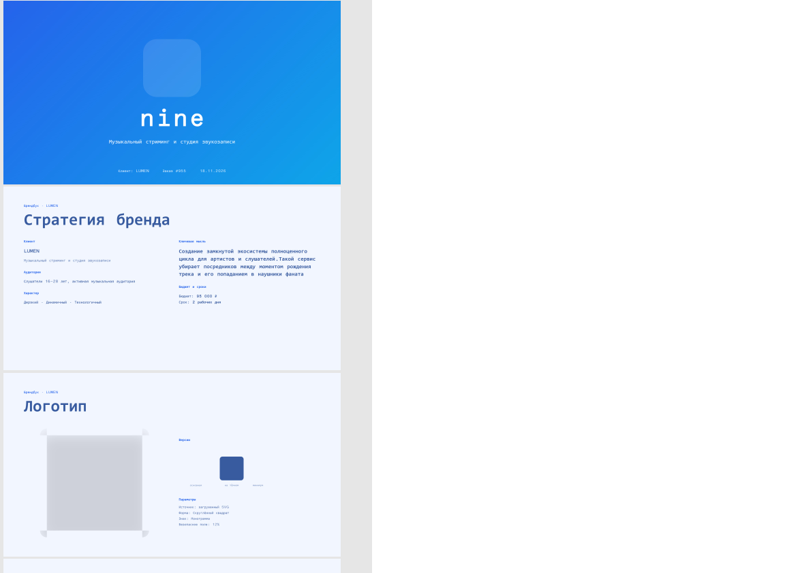

# 02_DESIGN_STUDIO

> **Дата:** 18.11.2026
> **Студент:** [Бушуев Николай Иванович]

## ОПИСАНИЕ
В рамках проекта разработана визуальная айдентика для бренда **NINE** — современного музыкального стримингового сервиса и студии звукозаписи. 

Целевая аудитория проекта — независимые музыканты, саунд-продюсеры и молодая цифровая аудитория, ценящая качественный звук и минималистичную эстетику. Главная идея дизайна заключается в объединении технологичности и творческой энергии: геометрический логотип отсылает к интерфейсам аудиоплееров, а насыщенный синий цвет палитры символизирует глубину звучания и доверие к бренду.

## БРЕНДБУК

## СОЗДАННЫЕ ФАЙЛЫ
- brandbook.pdf — итоговая презентация (брендбук)
- brandboard.svg — карточка фирменного стиля
- report.txt — текстовый отчёт по этапам
